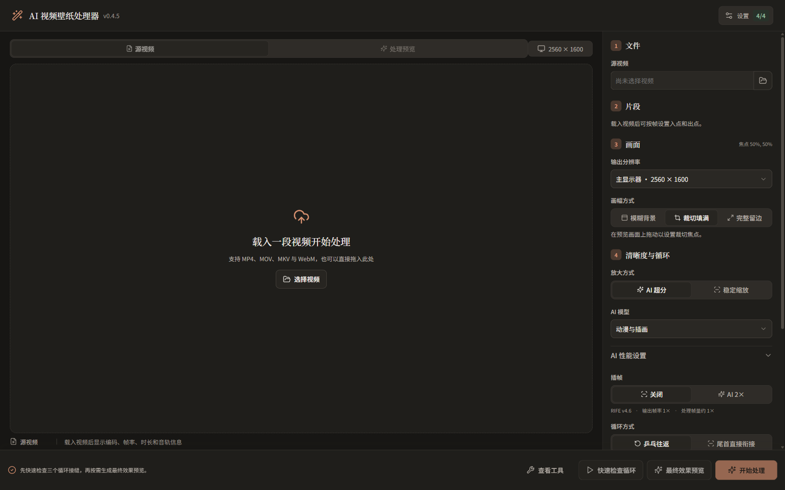
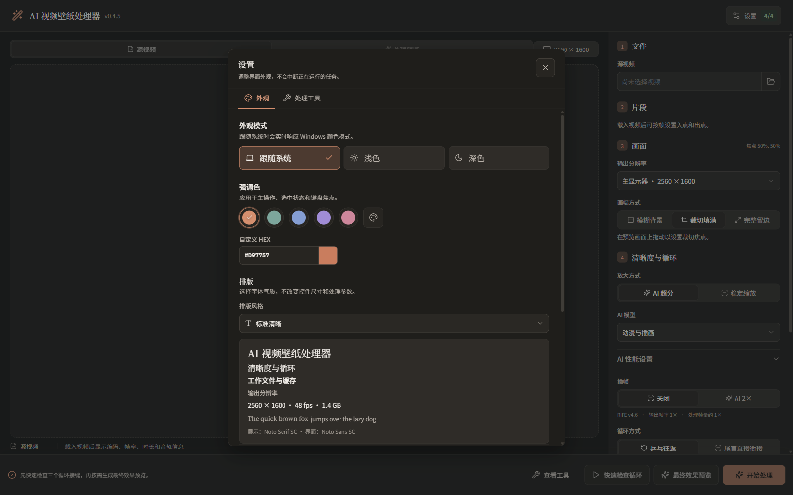

# AI 视频壁纸处理器

[](https://github.com/LinSam123123/wallpaper-video-processor/actions/workflows/ci.yml)
[](https://github.com/LinSam123123/wallpaper-video-processor/releases/latest)
[](LICENSE)

面向 Windows 的本地视频壁纸后处理工具。它把短视频裁切到显示器比例，可选使用 Real-ESRGAN AnimeVideo v3 超分与 RIFE v4.6 插帧，生成无音频、硬件易解码的 H.264 循环视频。



## 功能

- `cover`、模糊背景或完整留边三种画面适配方式，并可拖动焦点。
- 乒乓循环不会重复首尾端点，也支持直接首尾衔接。
- Real-ESRGAN AnimeVideo v3 动漫超分；无需放大时自动旁路 AI。
- RIFE v4.6 低帧率插帧；重复帧与硬切使用 hold，风险片段进入预览检查。
- 快速循环检查、最终效果预览、风险诊断和完整输出解码验证。
- 可恢复帧缓存、固定 tile、OOM 后整阶段重建和模型/工具版本缓存失效。
- 默认 `libx264 High / CRF 17 / slow`，兼顾质量和体积；NVENC 是显式快速模式。
- Electron 桌面端、JSON/JSONL CLI 和同一处理核心。



## 适用范围与限制

本项目是后处理器，不是生成式视频模型。Real-ESRGAN 和 RIFE 能改善放大观感与运动流畅度，但无法恢复源视频中从未存在的纹理、线条和真实运动信息。低清、压缩严重、文字变形、遮挡错误或强烈闪烁的源文件，最终效果仍主要受源素材限制。

当前正式方案固定为 Real-ESRGAN AnimeVideo v3 + RIFE v4.6。ComfyUI、Wan 和实验性 Python/CUDA 运行时不属于本仓库的产品路径。

## 系统要求

- Windows 10/11 x64。
- FFmpeg 8.0.1；AI 超分或插帧还需要支持 Vulkan 的 GPU。
- 推荐独立显卡与 8 GB 显存；更低配置可尝试较小 tile，但速度与可处理分辨率会受限。
- 足够的临时磁盘空间。逐帧 PNG 缓存可能明显大于最终 MP4。
- 从源码构建需要 Node.js 22.18 或更高版本和 npm。

## 安装

1. 从 [Releases](https://github.com/LinSam123123/wallpaper-video-processor/releases/latest) 下载 `AI-Video-Wallpaper-0.4.5-x64.exe`。
2. 安装后打开应用，进入“设置 > 处理工具”。
3. 按需安装 FFmpeg、Real-ESRGAN 和 RIFE。应用只会下载 `resources/dependencies.json` 中固定版本且 SHA-256 匹配的上游归档。
4. 先运行快速循环检查和最终效果预览，再开始完整处理。

### 未签名安装包

v0.4.5 安装包没有商业代码签名，Windows SmartScreen 可能显示“Windows 已保护你的电脑”。请只从本仓库的正式 Release 下载，并核对 Release 页面中的 SHA-256。安装包不会把 FFmpeg、Real-ESRGAN 或 RIFE 模型直接塞入应用；首次安装处理工具时会从清单列出的上游地址下载。

## 隐私

视频检查、逐帧处理、缓存和编码都在本机完成。应用不要求账户，不上传输入视频，也不包含遥测。只有用户在处理工具页面明确开始安装依赖时，应用才会访问清单中的下载地址。详细许可信息见 [THIRD_PARTY_NOTICES.md](THIRD_PARTY_NOTICES.md)。

## 从源码运行

```powershell
git clone https://github.com/LinSam123123/wallpaper-video-processor.git
cd wallpaper-video-processor
npm ci
npm run build
npm test
npm run dev
```

构建 Windows NSIS 安装器：

```powershell
npm run package:win
```

## CLI 示例

仓库提供中性的 JobSpec v4 示例：[examples/job-v4.json](examples/job-v4.json)。路径与源帧范围需按自己的素材修改。

```powershell
npm run cli -- doctor --json
npm run cli -- inspect --input "C:\Media\source.mp4" --json
npm run cli -- preview --config ".\examples\job-v4.json" --preview-mode segment --center 8.5 --json
npm run cli -- loop-preview --config ".\examples\job-v4.json" --output-dir ".\loop-previews" --json
npm run cli -- process --config ".\examples\job-v4.json" --json
npm run cli -- verify --input "C:\Media\source.wallpaper.mp4" --expected ".\examples\expected.json" --json
```

CLI 还支持 `diagnostic-preview`、`cache-status` 和 `cache-cleanup`。默认工作目录位于输出目录下的 `.ai-video-wallpaper-work`；预览和正式处理使用同一目录时可以复用缓存。

## 处理约定

JobSpec v4 明确记录超分和插帧后端、模型、帧范围、画面适配和编码设置。v1-v3 仍可读取，并会归一化到当前 ncnn 后端。乒乓顺序为 `F0...F(N-1),F(N-2)...F1`，总帧数为 `2N-2`，不会在转折点停顿一帧。

NVENC H.264 在当前支持路径上限制为单边不超过 4096 像素；更大目标应显式使用 `libx264`。最终验证会完整解码成品，并检查媒体规格、黑帧和冻结风险。

## 参与项目

提交问题前请阅读 [CONTRIBUTING.md](CONTRIBUTING.md)。安全问题请按 [SECURITY.md](SECURITY.md) 使用 GitHub 私密漏洞报告，不要公开提交包含个人视频、路径或日志的 Issue。

## English summary

Wallpaper Video Processor is a local Windows desktop and CLI tool for fitting short videos to a display, building seamless ping-pong loops, optionally upscaling anime footage with Real-ESRGAN AnimeVideo v3, and interpolating low-frame-rate footage with RIFE v4.6. It defaults to high-quality `libx264` output, keeps processing local, and downloads only pinned external tools after explicit user action. The models can improve presentation, but they cannot reconstruct detail or motion that is absent from the source.

## License

Project source code is released under the [MIT License](LICENSE). External runtime components and bundled fonts remain under their own licenses.
